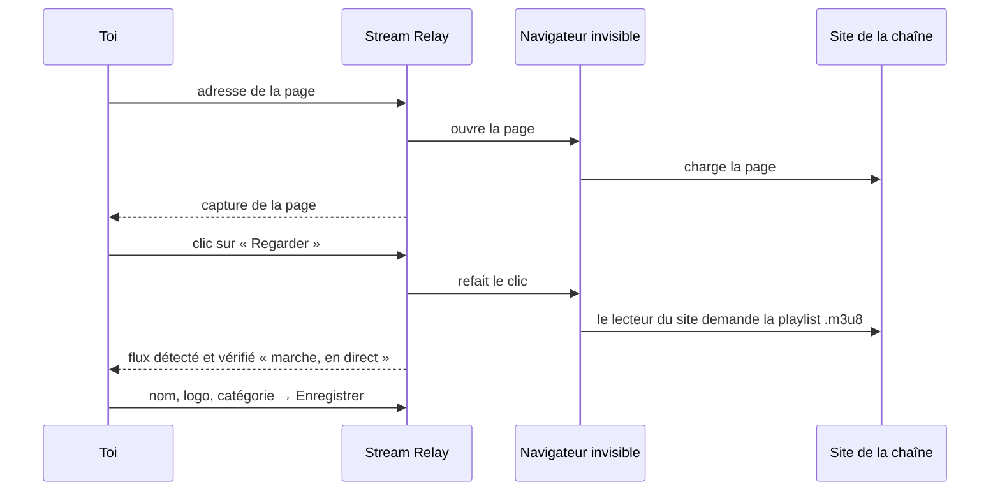
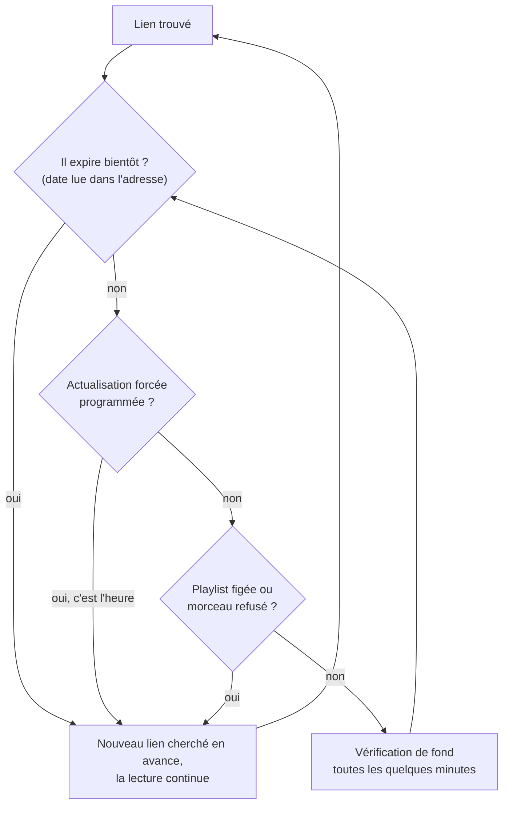
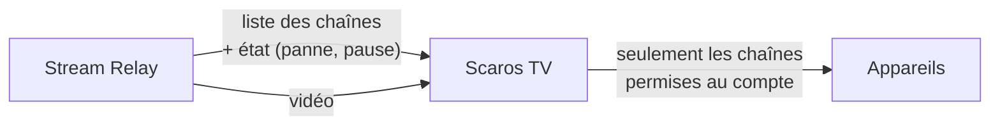

# Comment ça marche

Le trajet d'une chaîne, de la page du site jusqu'à l'écran, expliqué simplement.

- [Le problème de départ](#le-problème-de-départ)
- [1. Apprendre une chaîne](#1-apprendre-une-chaîne)
- [2. Retrouver le lien tout seul](#2-retrouver-le-lien-tout-seul)
- [3. Une adresse fixe qui relaie la vidéo](#3-une-adresse-fixe-qui-relaie-la-vidéo)
- [4. Garder le lien frais](#4-garder-le-lien-frais)
- [5. Quand quelque chose ne va pas](#5-quand-quelque-chose-ne-va-pas)
- [6. Scaros TV : l'écran](#6-scaros-tv--lécran)
- [7. Sécurité](#7-sécurité)
- [8. Léger pour le serveur](#8-léger-pour-le-serveur)

---

## Le problème de départ

Une chaîne en direct sur le web est presque toujours une **playlist HLS** (un fichier `.m3u8`) : une petite
liste qui donne les morceaux de vidéo de quelques secondes à télécharger les uns après les autres. Le lecteur la
relit sans arrêt pour connaître les morceaux suivants.

Le souci, c'est que l'adresse de cette playlist contient souvent un **jeton** (une suite de caractères) qui
expire au bout de quelques minutes ou quelques heures, et qu'elle n'est donnée qu'à la page du site, après avoir
cliqué au bon endroit. On ne peut donc pas la copier une fois pour toutes dans Jellyfin ou sur une télé.

## 1. Apprendre une chaîne

- La page s'ouvre dans un **navigateur invisible** sur le serveur. Tu la vois sous forme de capture, et chaque
  clic que tu fais dessus est rejoué dans ce navigateur.
- Stream Relay écoute tout ce que la page télécharge. Dès qu'une playlist vidéo passe, elle apparaît dans la
  liste, avec un verdict : elle marche en direct, c'est une vidéo qui se termine (souvent une pub), ou elle est
  refusée.
- À l'enregistrement, il retient la **série de clics** et la **forme du flux choisi** : sur quel serveur il est,
  le nom du fichier, le moment où il arrive (après combien de clics). C'est ce qui lui permettra de reconnaître
  *ta* chaîne parmi d'autres flux de la même page, même quand le jeton aura changé.

## 2. Retrouver le lien tout seul

Chaque fois qu'il faut un lien neuf, Stream Relay refait le chemin sans toi :

1. il ouvre la page dans le navigateur invisible ;
2. il attend une éventuelle vérification anti-robot automatique ;
3. il rejoue les clics appris ;
4. il guette le flux qui ressemble à celui appris, du plus sûr au moins sûr : même adresse, même forme, flux
   voisin ;
5. il **vérifie** le flux trouvé avec exactement les mêmes en-têtes et cookies que la lecture : il doit répondre
   et être un vrai direct.

Si le flux appris ne vient pas, il essaie dans l'ordre : lancer la lecture automatiquement, **fouiller le code
de la page** (y compris les liens cachés ou codés), ouvrir seuls les lecteurs intégrés de la page, puis un
deuxième essai plus lent. Une chaîne peut avoir **plusieurs sources** (d'autres sites ou serveurs) : elles sont
essayées l'une après l'autre, en commençant par celle qui a marché la dernière fois.

Un autre flux n'est pris « en secours » que s'il est le seul sur la page : mieux vaut « chaîne indisponible »
qu'une autre chaîne à la place.

## 3. Une adresse fixe qui relaie la vidéo

Jellyfin, Scaros TV et les lecteurs lisent toujours la **même adresse**, par exemple `/live/sport-arena.m3u8`.
Derrière, Stream Relay :

- télécharge la playlist du site avec le lien du moment ;
- **réécrit** les adresses des morceaux de vidéo pour qu'ils passent aussi par lui (avec les bons en-têtes et
  cookies du site) ;
- transmet les morceaux **tels quels**, sans les convertir ;
- **précharge** les morceaux suivants pendant qu'on regarde, et les partage entre tous les écrans qui regardent
  la même chaîne : le site n'est sollicité qu'une fois.

Cas particuliers gérés en plus : un flux `.ts` continu (fréquent dans les listes IPTV) est découpé en morceaux
pour les navigateurs et l'iPhone, et un site qui envoie l'image et le son séparément est réuni en un seul flux.

Le dossier [exemple/](exemple/) contient un mini-relais d'une soixantaine de lignes qui montre ce principe de
base (sans tout le reste).

## 4. Garder le lien frais

- Beaucoup d'adresses contiennent leur date d'expiration : le lien est renouvelé **un peu avant**, pendant
  que la lecture continue avec l'ancien.
- Une **actualisation forcée** peut être programmée par chaîne (toutes les N minutes), pour les sites qui
  coupent sans prévenir.
- Une playlist qui ne bouge plus, ou un morceau refusé, déclenche aussi une nouvelle recherche.
- Une **vérification de fond** passe sur chaque chaîne, une à la fois. Tant que le lien marche, c'est une simple
  requête. La page n'est rouverte que s'il ne marche plus. Résultat : la chaîne démarre tout de suite.
- Les liens trouvés sont **gardés sur le disque** : après un redémarrage du serveur, ils sont repris s'ils
  marchent encore, au lieu de rouvrir toutes les pages d'un coup.
- Une recherche ne peut pas durer indéfiniment : une page bloquée est abandonnée au bout de quelques minutes,
  pour ne jamais figer les autres chaînes.

## 5. Quand quelque chose ne va pas

- **Chaîne en panne** : Jellyfin reçoit 10 secondes d'un écran « Chaîne indisponible pour le moment » au lieu
  d'une erreur. Les nouveaux essais sont de plus en plus espacés, pour ne pas marteler le site, et la chaîne
  revient toute seule.
- **Chaîne en pause** (choisie par l'administrateur) : un écran « Chaîne en pause », et le site n'est plus
  sollicité.
- **Journal par chaîne** en français clair (« le site bloque l'appli avec une vérification anti-robot », « la
  page affiche : Le direct est hors ligne »…), avec une **capture de la page** au moment de l'échec.
- **Alertes Telegram** : quand une chaîne est en panne depuis un moment, quand elle revient, et si la
  vérification de fond se bloque.

## 6. Scaros TV : l'écran

- Scaros TV lit chez Stream Relay la **liste des chaînes** (numéros, noms, logos, catégories) et leur **état**.
  Tout se règle à un seul endroit.
- La vidéo passe par Scaros TV, qui vérifie à chaque fois **qui regarde** : un compte limité à certaines
  catégories ne peut pas lire les autres chaînes, même en devinant leur adresse.
- Le **lecteur** utilise de préférence hls.js (le même partout, qui corrige les flux mal horodatés), ou le
  lecteur intégré de l'appareil. Si l'image se fige alors que le son continue, il essaie l'autre lecteur.
- Le **mode télé** est pensé pour la télécommande (navigation aux flèches, zapping, chiffres) et pour les
  navigateurs de télé, souvent anciens.
- Les **messages** de l'administrateur arrivent avec la liste des chaînes. Une maintenance peut **bloquer** des
  chaînes : le serveur refuse alors leur vidéo, et l'écran affiche le message à la place.
- L'**appli Android** (téléphone et Android TV) lit avec ExoPlayer, y compris le son Dolby. Elle demande au
  serveur s'il y a une nouvelle version et s'installe par-dessus l'ancienne.

## 7. Sécurité

- Les mots de passe et codes ne sont **jamais enregistrés en clair**, seulement une empreinte (scrypt).
  Après plusieurs erreurs, il faut attendre avant de réessayer.
- Les flux peuvent être protégés par une **clé** : sans elle, Stream Relay refuse tout. Scaros TV la garde pour
  lui, les appareils ne la voient jamais.
- Chaque compte de Scaros TV peut être suspendu ou déconnecté de tous ses appareils d'un coup.

## 8. Léger pour le serveur

- **Aucune conversion vidéo** : c'est l'appareil qui décode, le serveur ne fait que transmettre.
- La vérification de fond passe sur les chaînes une à la fois, et le navigateur invisible se ferme tout seul
  quand il ne sert plus.
- Tant qu'un lien marche, le garder prêt ne coûte qu'une petite requête de temps en temps.
