

  
  &nbsp;&nbsp;&nbsp;&nbsp;
  

<h3 align="center">Les chaînes en direct des sites web, sur tous tes écrans, comme une box TV.</h3>

  <a href="#stream-relay">Stream Relay</a> ·
  <a href="#scaros-tv">Scaros TV</a> ·
  <a href="FONCTIONNEMENT.md">Comment ça marche</a> ·
  <a href="exemple/">Petit exemple de code</a> ·
  <a href="#licence">Licence</a>

---

> **Ce dépôt est une vitrine.** Il présente deux applications faites maison qui fonctionnent ensemble :
> ce qu'elles font, à quoi elles ressemblent et comment elles marchent. **Le code complet n'est pas public.**
> Seul un petit exemple simplifié est fourni pour montrer le principe.

## En deux phrases

Beaucoup de sites diffusent des chaînes en direct, mais leur lien vidéo change sans arrêt ou expire au bout de
quelques minutes. **Stream Relay** va chercher ce lien tout seul et le garde à jour. **Scaros TV** affiche les
chaînes sur la télé, le téléphone et l'ordinateur, comme une box TV.

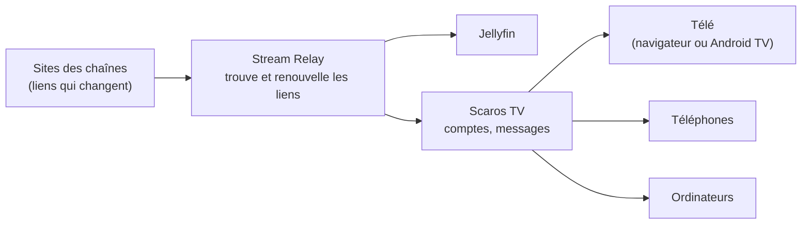

Les deux tournent sur un petit serveur à la maison (CasaOS / Docker). **La vidéo n'est jamais convertie** :
c'est l'appareil qui la lit, le serveur ne fait que la transmettre. Pas besoin de carte graphique.

---

## Stream Relay

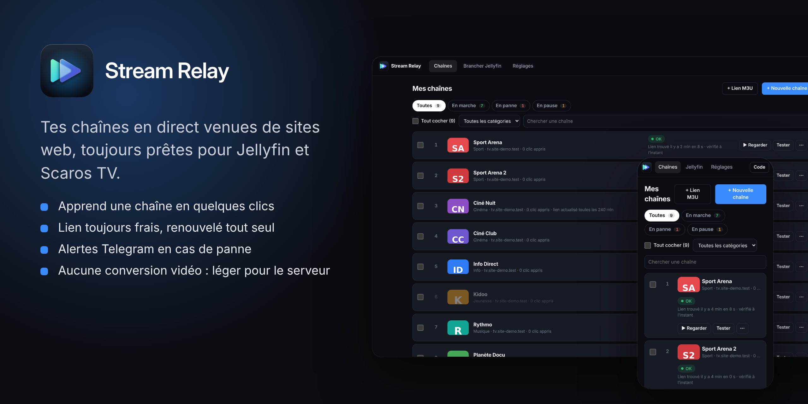

**Tu lui montres une fois comment regarder la chaîne sur le site, il s'occupe du reste.** La page du site
s'affiche dans l'interface : tu cliques comme d'habitude (choix du serveur, bouton lecture…). Stream Relay
retient ces clics et le flux vidéo. Ensuite, il refait tout seul ces clics dans un navigateur invisible chaque
fois qu'il faut un lien neuf.

- **Lien toujours frais** : renouvelé avant qu'il expire, sans couper la lecture.
- **Chaînes toujours prêtes** : vérifiées en arrière-plan, elles démarrent tout de suite.
- **Le bon flux, pas un autre** : chaque flux est vérifié. Les pubs, les extraits et les autres chaînes sont écartés.
- **Plusieurs sources par chaîne** : si un site ne marche pas, le suivant est essayé.
- **Liens M3U et listes IPTV** acceptés aussi.
- **Jellyfin** : une playlist et un guide des programmes prêts à brancher.
- **Alertes Telegram** quand une chaîne tombe en panne et quand elle revient.
- **Explications en clair** : journal par chaîne et capture de la page au moment d'un échec.

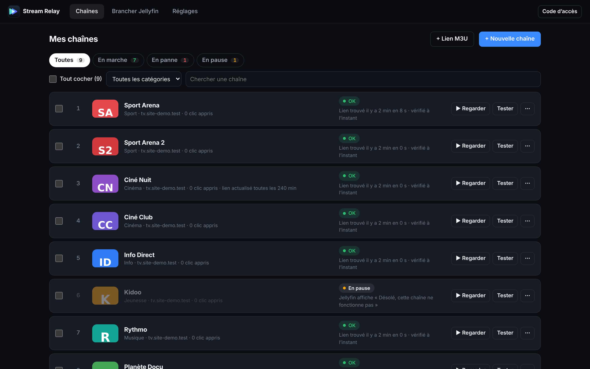

<table>
<tr>
<td width="50%"><b>Apprendre une chaîne</b> 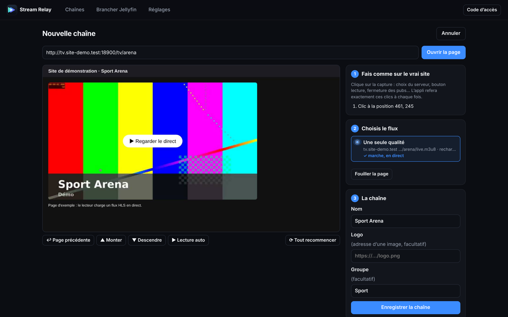</td>
<td width="50%"><b>Journal et capture en cas d'échec</b> 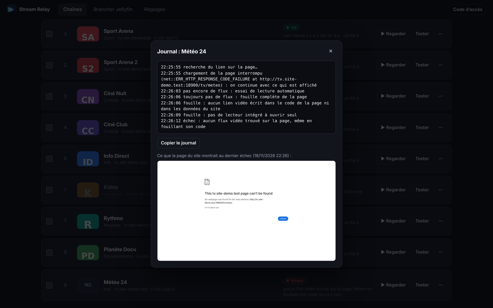</td>
</tr>
<tr>
<td><b>Brancher Jellyfin</b> 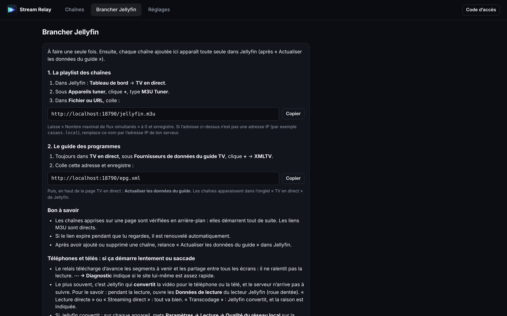</td>
<td><b>Réglages</b> 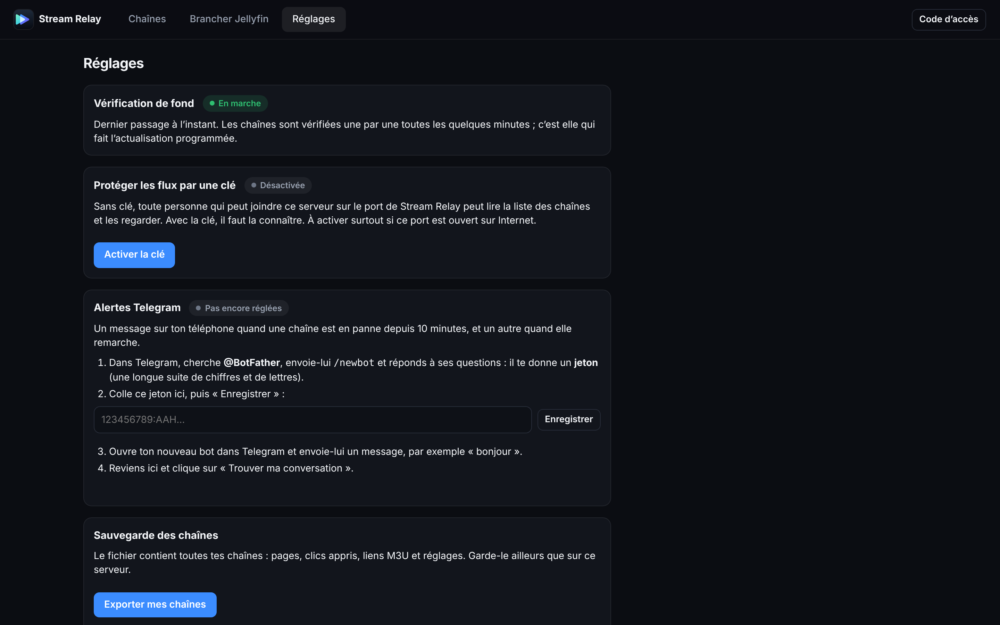</td>
</tr>
</table>

---

## Scaros TV

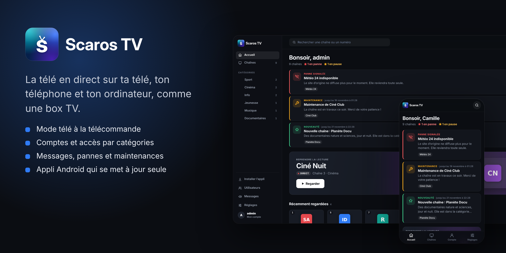

**Le lecteur fait pour Stream Relay.** Il affiche les chaînes sur tous les écrans de la maison, avec des comptes
pour chaque membre de la famille.

- **Mode télé** : grandes cases à la télécommande, zapping avec P+ / P− et les chiffres.
- **Téléphone et ordinateur** : accueil façon application, « Reprendre », catégories, recherche.
- **Appli Android** pour téléphone et Android TV, qui se met à jour toute seule.
- **Comptes** : chacun son mot de passe, et les chaînes visibles limitées par catégorie si besoin.
- **Messages** : annonces, pannes, maintenances, avec une durée au choix.
- **Bloquer une chaîne** pendant une maintenance : elle affiche le message au lieu de la vidéo.
- **État des chaînes** : point rouge en cas de panne, point orange en pause, rien quand tout marche.

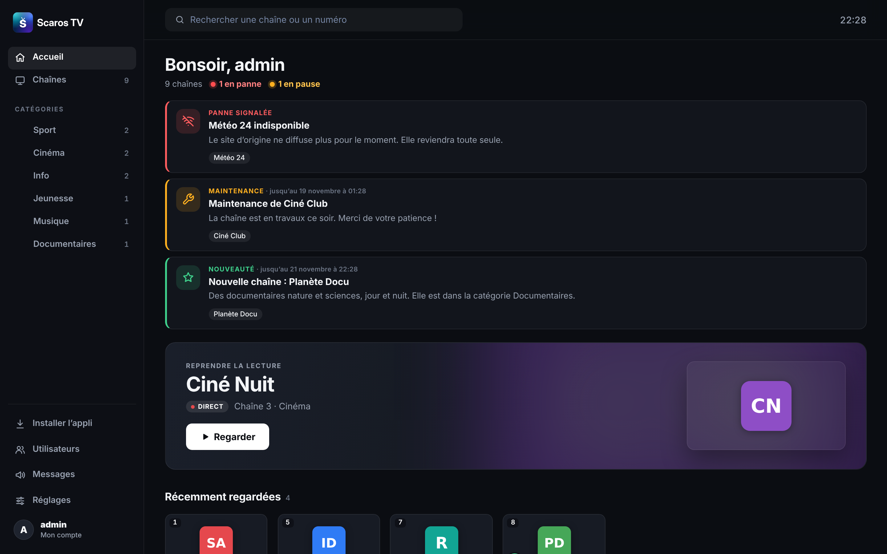

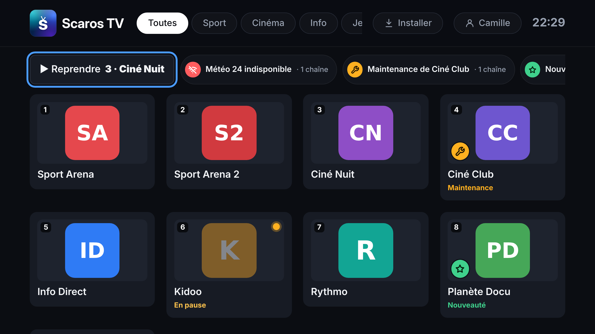

<table>
<tr>
<td width="50%"><b>Le lecteur</b> 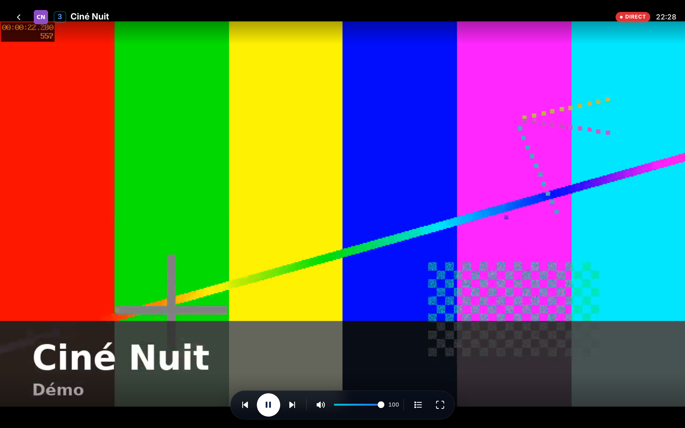</td>
<td width="50%"><b>Chaîne bloquée pendant une maintenance</b> 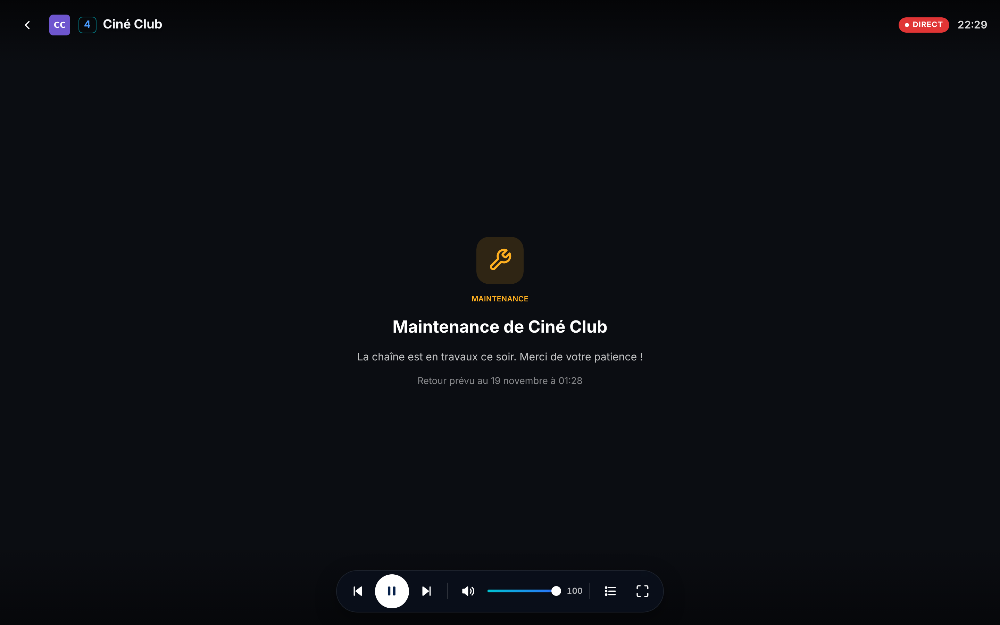</td>
</tr>
<tr>
<td><b>Écrire un message</b> 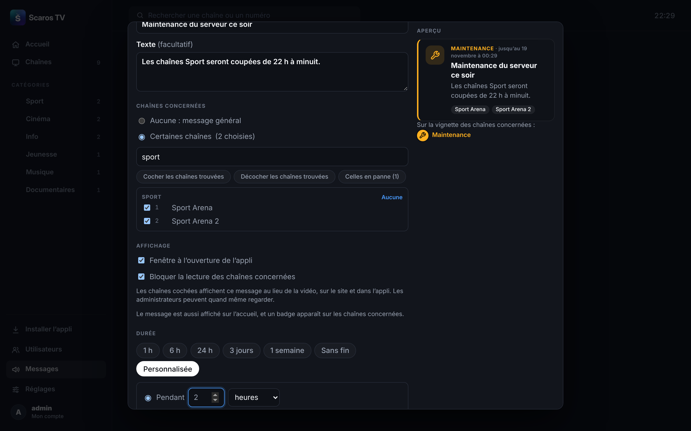</td>
<td><b>Comptes et accès par catégories</b> 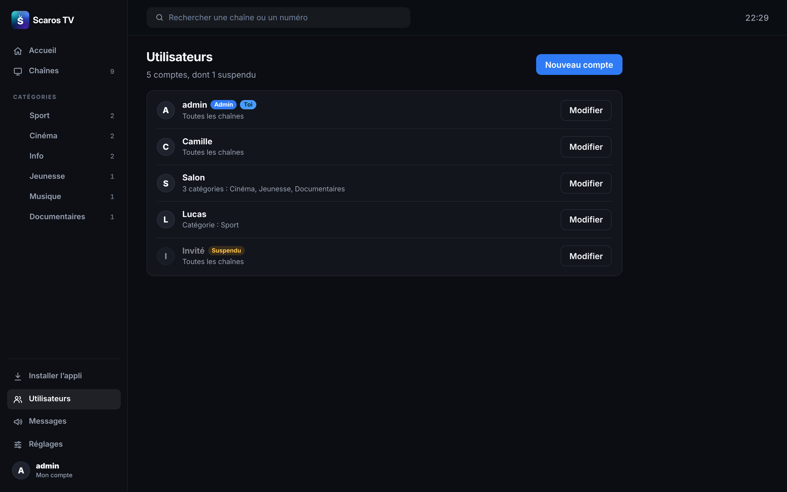</td>
</tr>
</table>

  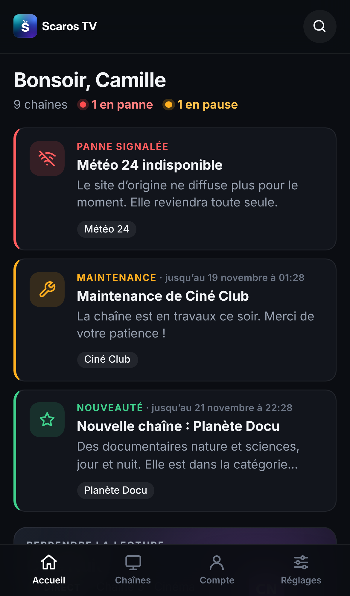
  &nbsp;
  
  &nbsp;
  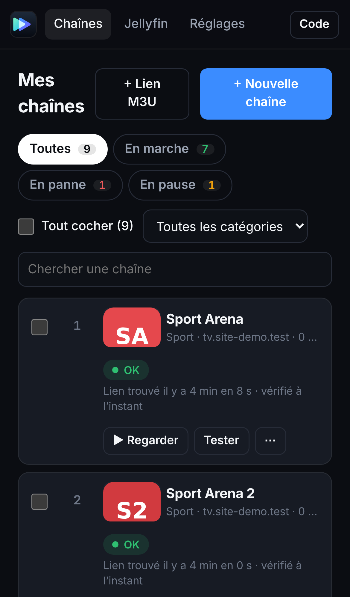

> Toutes les captures utilisent des **chaînes de démonstration** inventées et une mire de test.

---

## Pour aller plus loin

- **[Comment ça marche](FONCTIONNEMENT.md)** : le trajet d'une chaîne, de la page du site jusqu'à ta télé,
  expliqué simplement, avec des schémas.
- **[Petit exemple de code](exemple/)** : un mini-relais d'une soixantaine de lignes qui montre le principe de
  base (une adresse fixe qui relaie une vidéo en direct sans la convertir). Ce n'est **pas** Stream Relay.

## Questions

Ce sont des projets personnels : ils ne sont ni vendus ni distribués. Pour une question, ouvre une
**issue** sur ce dépôt.

## Licence

**Tous droits réservés.** Les textes, images, captures, logos et le code de ce dépôt ne peuvent être ni
copiés, ni modifiés, ni redistribués, ni réutilisés sans autorisation écrite. Voir [LICENSE](LICENSE).
